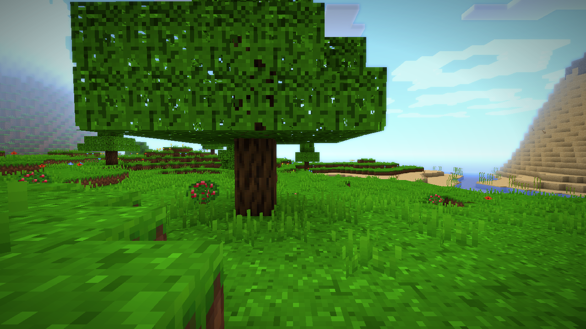
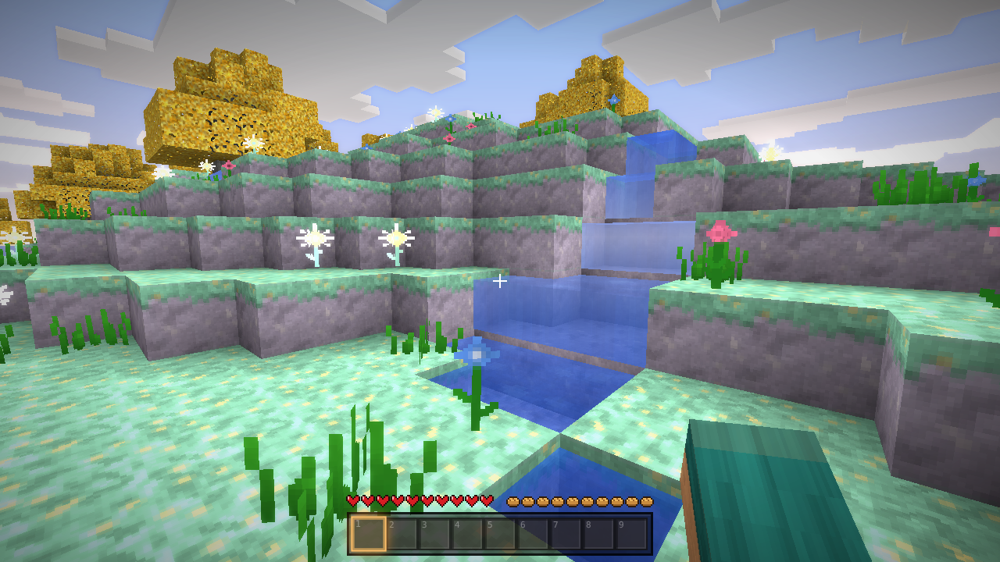
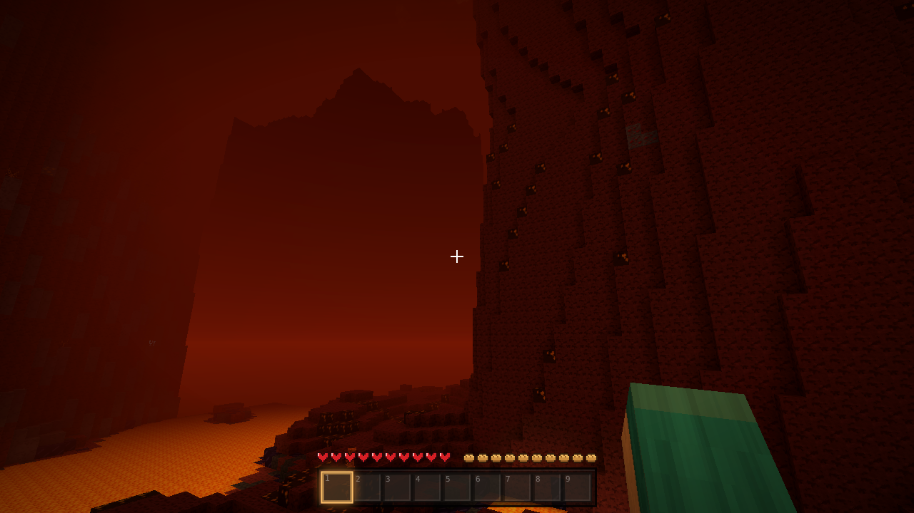
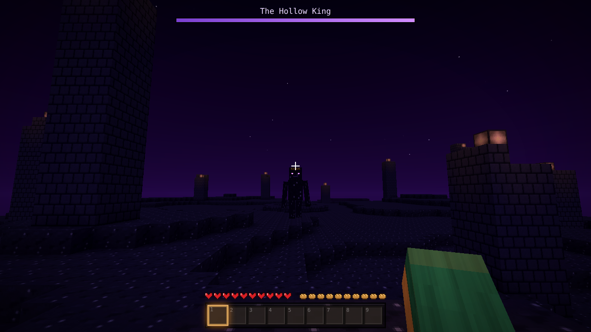
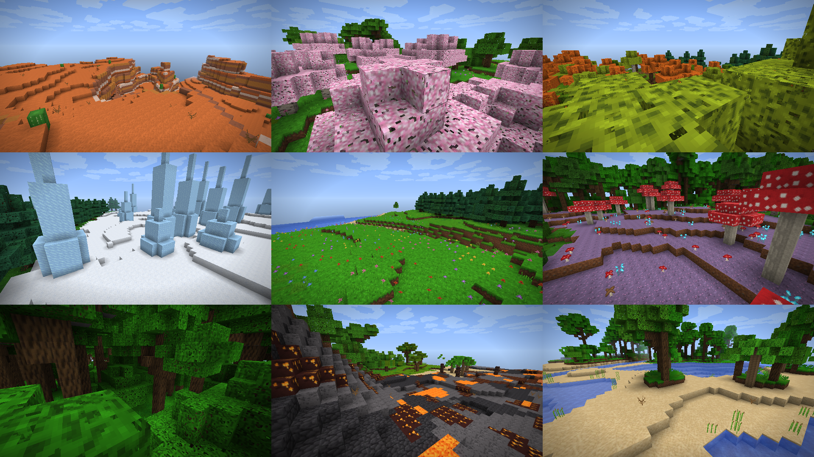
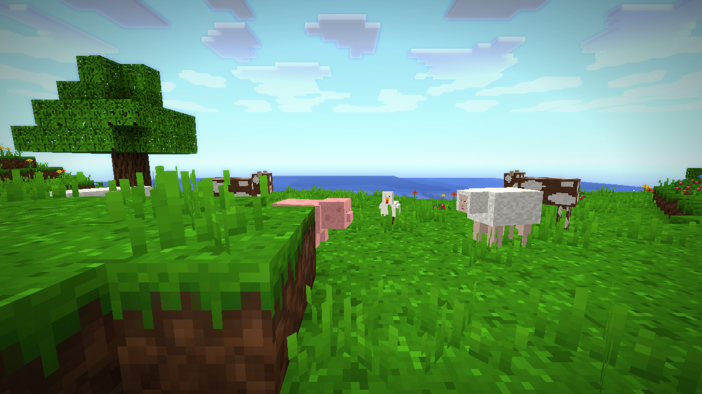
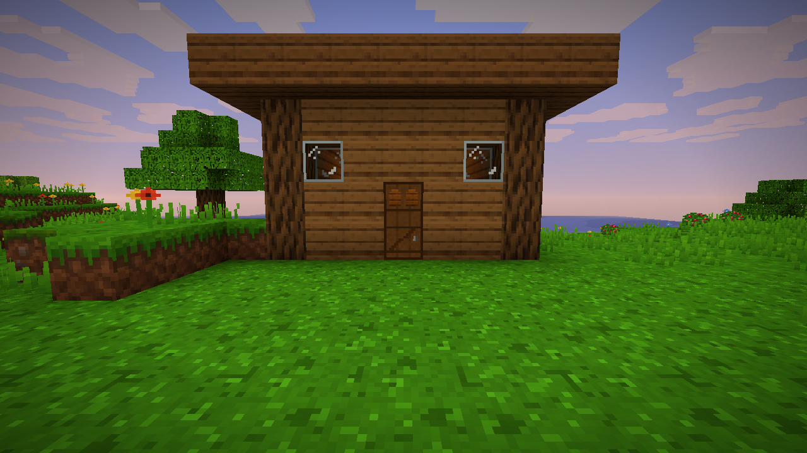

# Emberwild

**An original voxel survival sandbox that runs entirely in your browser.**
Endless procedurally generated worlds, survival and creative modes, crafting, smelting, armour, creatures, weather, day/night — plus multiplayer parties and PVP servers.

### ▶ [Play it now](https://szabozeno2016-star.github.io/emberwild/)



### New in v2.0 — realms, phones and a lot more world
- **Three new realms**, reached through craftable gates:
  - **The Emberdeep** — a burning underworld of cinderstone, lava seas, glowing charwood and Scorchlings. *Ember Gate = 8 Cobblestone + 4 Ember Dust + 2 Sunvein Ingots.*
  - **The Aether** — peaceful islands above the clouds with silverwood trees, bouncy clouds and Aurorite. Nothing there attacks you. *Sky Gate = 4 Wool + 4 Glass + 2 Skyshards.*
  - **The Hollow** — the last realm. Defeat the Hollow King to finish the game. *Hollow Gate = 4 Voidglass + 6 Cinder Shards + 3 Cinder Hearts, all found in the Emberdeep.*
  - Place a gate and right-click it (tap it on a phone). A gate on the other side brings you home. The same guide is in the game under **Settings → How to reach the Realms**.
- **Plays on phones and tablets** — the game notices a touch screen by itself and shows a thumb stick, jump and sneak buttons, drag-to-look, tap to place or use, and hold to break.
- **10 more biomes** — rainforest, painted canyon, blossom grove, amber woods, ice spikes, frozen sea, flower meadow, mushroom vale, ashlands and palm shore (25 in the Overworld now).
- **About 65 new blocks** — bricks, baked clay, dyed wool in 8 colours, lamps, bookshelves, hay, moss, ice, mud, ore blocks, palm and silverwood, and everything the realms are made of.
- **Sharper textures** — every texture is redrawn at double resolution with smoother edges and finer detail.
- **Choose your graphics on first launch**, and **change your avatar any time** from the title screen or the pause menu.



| The Emberdeep | The Hollow |
|---|---|
|  |  |



### New in v1.2 — the big world update
- **Biomes** — plains, forests, birch and dark forests, taiga, snowy plains, deserts with cacti, savannas, swamps, rivers, beaches, oceans, windswept hills and snowy peaks. Grass and leaves change colour from biome to biome.
- **Farm animals** — sheep, cows, pigs and hens roam in herds. Sheep give wool, cows give hide, and all of them give food.
- **Chests** — 27 slots of storage that face whoever places them, are saved with your world, and are shared live in multiplayer.
- **Doors & ladders** — wooden doors that open and close (and keep night creatures out) and ladders to climb up cliffs and down mines.
- **New blocks** — sandstone, gravel, clay, cactus, dead bushes, snowy grass and wool. Mind the cactus: it hurts.
- Smoother, more natural terrain with rivers and mountains, and spawn points on friendly flat ground. Worlds made before v1.2 keep their original terrain.

| Farm animals | A cabin with a door |
|---|---|
|  |  |

## Features

- **Infinite worlds** — seeded terrain with 15 biomes, rivers, mountains, caves, ores and glowing mushrooms.
- **Survival** — health, hunger, fall damage, drowning; craft tools from wood to Skyshard, smelt ores in furnaces, cook food on campfires, sleep in beds.
- **Creative** — fly (double-tap Space), instant breaking, and a catalogue of every block.
- **Creatures** — Gloomlings that hunt at night, Duskcrawlers deep in the caves, grazing Mossbacks and herds of sheep, cows, pigs and hens.
- **Building** — chests, doors, ladders, beds, furnaces, workbenches, torches, glass, bricks and more.
- **Armour** — Hide, Sunvein and Skyshard sets.
- **Atmosphere** — rain and thunderstorms, fireflies, campfire smoke, synthesized sound effects and generative music.
- **Six graphics levels** — Potato, Bad, Medium, Normal, Good and Heavenly (bloom, sun & moon rays, cinematic colour).
- **Accounts & skins** — create an account or play as an anonymous guest; customise your character.
- **Multiplayer parties** — host one of your worlds and share a 6-character code or an invite link. If the host leaves, the next player takes over and the party keeps going.
- **Direct connections** — players connect straight to each other (WebRTC) for low lag, with the public relay as an automatic backup. Movement is buffered and replayed smoothly.
- **Proximity voice chat** — open mic or push-to-talk; voices get quieter with distance.
- **Social** — chat history, speech bubbles above players, private messages and commands (`/msg`, `/tp`, `/me`, `/list`), and a Tab player list showing everyone's connection and ping. You hear and see other players build, break, walk and fight.
- **Servers** — the official **PVP** server, plus servers anyone can create (PVP, Survival or Creative) that stay open to join.

| Servers | PVP |
|---|---|
|  |  |

## Controls

| Key | Action |
|---|---|
| W A S D | Move |
| Mouse | Look |
| Left click (hold) | Mine / attack |
| Right click | Place / use / eat · open chests and doors · travel through gates |
| Space | Jump (double-tap to fly in Creative) |
| Shift / Ctrl | Sneak / sprint |
| E | Inventory & crafting |
| 1–9, mouse wheel | Choose hotbar slot |
| Q | Drop item |
| T | Chat (multiplayer); `/` opens commands |
| Tab (hold) | Player list with connection and ping |
| V (hold) | Push to talk (when voice chat is on) |
| F5 | Change camera view |
| Esc | Pause |

## Running it

The whole game is a single file — **`index.html`**. Open it in any modern browser with WebGL2 (Chrome, Edge, Brave, Firefox, Safari 15+), or use the GitHub Pages link above.

**Multiplayer works everywhere.** On GitHub Pages (or any website) parties and servers connect through free public MQTT relays — two at once, so one going down doesn't stop the game. When the game is opened from its hosted app link it uses that host's own live connection instead, and accounts can also be saved online there. Elsewhere, accounts and single-player worlds are kept in your browser.

Shared server worlds and server listings are stored on the public relays, so anyone running the game can see them — don't put anything private in server names.

## Building from source

The source lives in `src/`: `src/template.html` (page, styles and menus) and `src/js/*.js` (engine and game). `textures/atlas.png` is the texture atlas.

```bash
python3 build.py   # writes index.html with every script and the atlas inlined
```

| File | What it does |
|---|---|
| `core.js` | Maths, noise, blocks, items, recipes, settings, graphics presets |
| `world.js` | Original terrain generator, caves, lighting, chunk meshing, chest storage |
| `world2.js` | v1.2 terrain: climate, biomes, rivers, mountains, trees and biome colours |
| `world3.js` | v2.0 terrain: ten more biomes and the generators for the Emberdeep, the Aether and the Hollow |
| `realms.js` | Gates, travelling between realms, the Hollow King and the ending |
| `render.js` | WebGL2 renderer, sky, clouds, water, bloom and sun-ray post-processing |
| `entities.js` | Physics, particles, item drops, creatures |
| `audio.js` | Synthesized sound effects, ambience and music |
| `storage.js` | Accounts, profiles and world saves |
| `skins.js` | Player skins and character model |
| `relay.js` | Multiplayer anywhere: tiny MQTT-over-WebSocket client, rooms and shared storage on public relays, plus direct WebRTC links |
| `voice.js` | Proximity voice chat |
| `net.js` | Multiplayer parties and server sessions |
| `servers.js` | Server list, creation and shared world saving |
| `atmos.js` | Weather and ambient effects |
| `game.js` | Game loop, player, combat, crafting, furnaces |
| `ui.js`, `ui_mp.js` | Menus, HUD, inventory, settings, profiles, servers |
| `main.js` | Start-up, input and window handling |

## Credits

Emberwild is an original game made by **Zénó**. Every sound and note is synthesized live in the browser.
