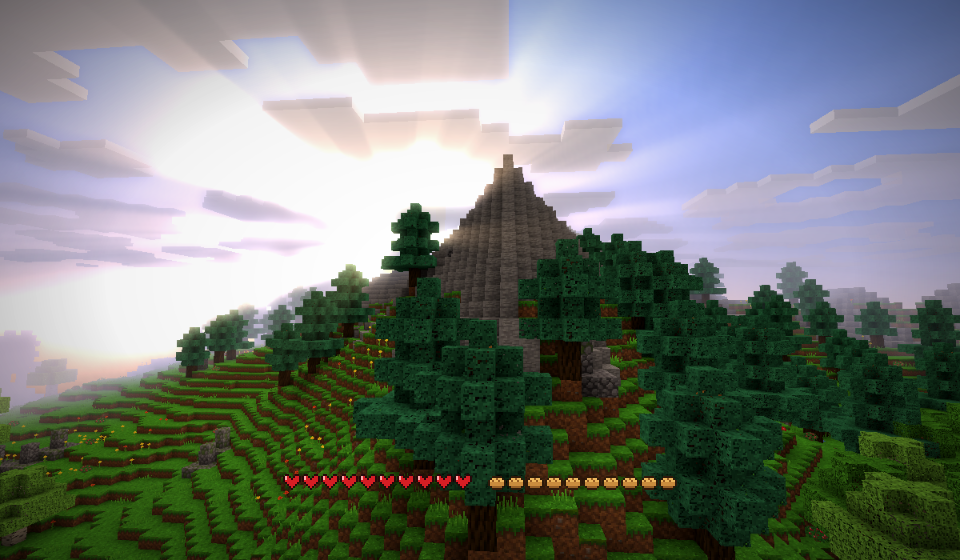
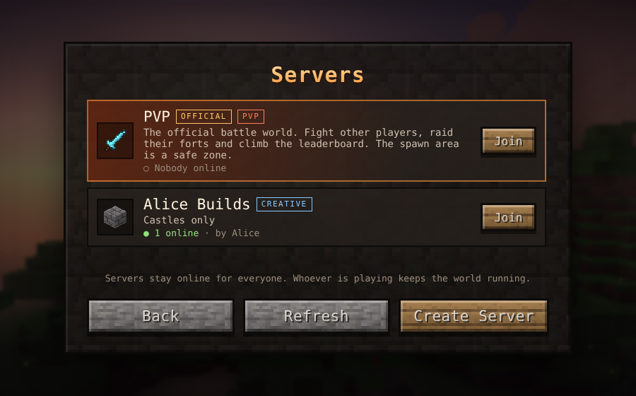
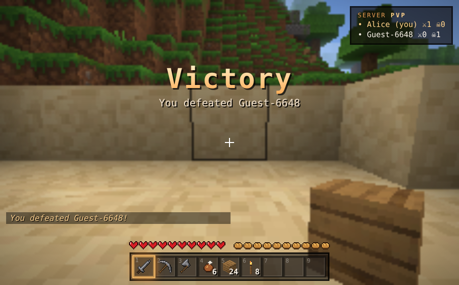

# Emberwild

**An original voxel survival sandbox that runs entirely in your browser.**
Endless procedurally generated worlds, survival and creative modes, crafting, smelting, armour, creatures, weather, day/night — plus multiplayer parties and PVP servers.

### ▶ [Play it now](https://szabozeno2016-star.github.io/emberwild/)



## Features

- **Infinite worlds** — seeded terrain with forests, beaches, snowy peaks, caves, ores and glowing mushrooms.
- **Survival** — health, hunger, fall damage, drowning; craft tools from wood to Skyshard, smelt ores in furnaces, cook food on campfires, sleep in beds.
- **Creative** — fly (double-tap Space), instant breaking, and a catalogue of every block.
- **Creatures** — Gloomlings that hunt at night, grazing Mossbacks, and Duskcrawlers deep in the caves.
- **Armour** — Hide, Sunvein and Skyshard sets.
- **Atmosphere** — rain and thunderstorms, fireflies, campfire smoke, synthesized sound effects and generative music.
- **Six graphics levels** — Potato, Bad, Medium, Normal, Good and Heavenly (bloom, sun & moon rays, cinematic colour).
- **Accounts & skins** — create an account or play as an anonymous guest; customise your character.
- **Multiplayer parties** — host one of your worlds and share a 6-character code.
- **Servers** — the official **PVP** server, plus servers anyone can create (PVP, Survival or Creative) that stay open to join.

| Servers | PVP |
|---|---|
|  |  |

## Controls

| Key | Action |
|---|---|
| W A S D | Move |
| Mouse | Look |
| Left click (hold) | Mine / attack |
| Right click | Place / use / eat |
| Space | Jump (double-tap to fly in Creative) |
| Shift / Ctrl | Sneak / sprint |
| E | Inventory & crafting |
| 1–9, mouse wheel | Choose hotbar slot |
| Q | Drop item |
| T | Chat (multiplayer) |
| F5 | Change camera view |
| Esc | Pause |

## Running it

The whole game is a single file — **`index.html`**. Open it in any modern browser with WebGL2 (Chrome, Edge, Brave, Firefox, Safari 15+), or use the GitHub Pages link above.

**Multiplayer works everywhere.** On GitHub Pages (or any website) parties and servers connect through free public MQTT relays — two at once, so one going down doesn't stop the game. When the game is opened from its claude.ai link it uses claude.ai's own live connection instead, and accounts can also be saved online there. Elsewhere, accounts and single-player worlds are kept in your browser.

Shared server worlds and server listings are stored on the public relays, so anyone running the game can see them — don't put anything private in server names.

## Building from source

The source lives in `src/`: `src/template.html` (page, styles and menus) and `src/js/*.js` (engine and game). `textures/atlas.png` is the texture atlas.

```bash
python3 build.py   # writes index.html with every script and the atlas inlined
```

| File | What it does |
|---|---|
| `core.js` | Maths, noise, blocks, items, recipes, settings, graphics presets |
| `world.js` | Terrain generation, caves, lighting, chunk meshing |
| `render.js` | WebGL2 renderer, sky, clouds, water, bloom and sun-ray post-processing |
| `entities.js` | Physics, particles, item drops, creatures |
| `audio.js` | Synthesized sound effects, ambience and music |
| `storage.js` | Accounts, profiles and world saves |
| `skins.js` | Player skins and character model |
| `relay.js` | Multiplayer without claude.ai: tiny MQTT-over-WebSocket client, rooms and shared storage on public relays |
| `net.js` | Multiplayer parties and server sessions |
| `servers.js` | Server list, creation and shared world saving |
| `atmos.js` | Weather and ambient effects |
| `game.js` | Game loop, player, combat, crafting, furnaces |
| `ui.js`, `ui_mp.js` | Menus, HUD, inventory, settings, profiles, servers |
| `main.js` | Start-up, input and window handling |

## Credits

Emberwild is an original game, built with Claude from the player's brief. The texture pack was supplied by the player; every sound and note is synthesized live in the browser.
